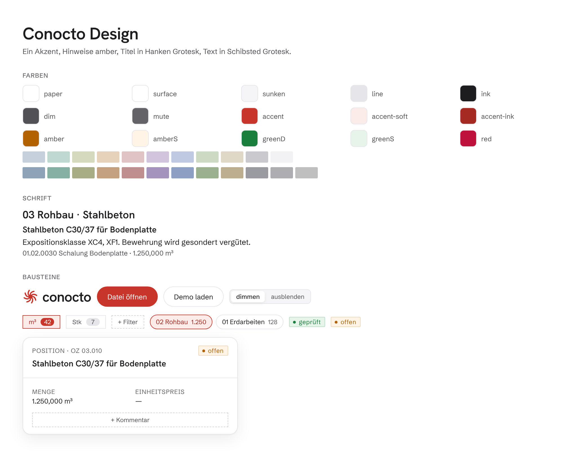
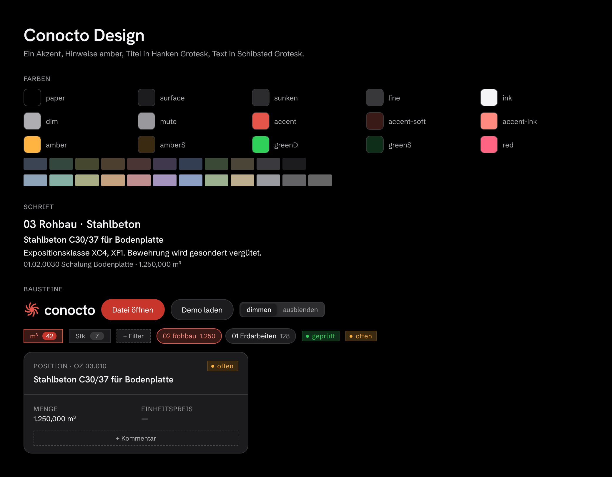

# Conocto Design

Das gemeinsame Aussehen aller Conocto-Produkte (LV-Viewer, BIM-Viewer, …):
Farben, Schriften, Logo und fertige Bausteine. Einmal hier ändern, überall gleich.



<details><summary>Dunkel</summary>



</details>

## Was drin ist

| Ordner / Datei | Inhalt |
| --- | --- |
| `tokens/tokens.json` | Alle Werte: 90 Farben (hell + dunkel), Schriftgrößen, Abstände, Radien, Schatten. **Die eine Quelle.** |
| `tokens/tokens.css` | Dieselben Werte als CSS-Variablen. Wird aus der JSON erzeugt, nie von Hand ändern. |
| `styles.css` | Grundstil und schwebende Flächen (`cn-window`, `cn-glass`, `cn-pill`, `cn-btn`). |
| `fonts.js` | Lädt Hanken Grotesk (Titel) und Schibsted Grotesk (Text), ohne Google-Aufruf. |
| `tailwind-preset.cjs` | Farben und Schriften für Tailwind. |
| `src/` | 10 React-Bausteine: Logo, Knopf, Chips, Umschalter, Status, Panel-Kopf, Eigenschaft, Leerzustand, Fläche. |
| `assets/logo/` | Krake als SVG, hell und dunkel, groß und klein. |
| `claude-skill/` | Anleitung für Claude, damit Entwürfe in anderen Repos automatisch im Conocto-Look entstehen. |

## In einem Projekt nutzen

Kurzfassung (Details und Token-Einrichtung: [docs/einbinden.md](docs/einbinden.md)):

```bash
npm install github:NicPalapte/conocto-design#v0.1.0
```

```ts
import '@conocto/design/fonts';
import '@conocto/design/index.css';
import { ConoctoLogo, Button } from '@conocto/design';
```

## Werte ändern

1. Wert in `tokens/tokens.json` ändern.
2. `npm run tokens` ausführen, das schreibt `tokens/tokens.css` neu.
3. Neue Version taggen (z. B. `v0.2.0`) und in den Projekten die Version hochsetzen.

Vorschaubilder neu erzeugen: `npm run vorschau`, dann `docs/vorschau.html` im Browser öffnen
und je Thema einen Screenshot speichern.

Die CI prüft bei jedem PR, dass CSS und JSON zusammenpassen und alle Bausteine fehlerfrei rendern.

## Regeln in Kürze

- Ein Akzent: Ziegelrot `accent`. Nur für Auswahl und Klickbares.
- Hinweise amber, nie rot. Rot nur für echte Fehler.
- Titel in Hanken Grotesk, alles andere in Schibsted Grotesk.
- Jede Farbe über eine Variable, nie eine Hex-Farbe direkt im Code.

Ausführlich: [claude-skill/conocto-design/SKILL.md](claude-skill/conocto-design/SKILL.md).

## Herkunft

Übernommen aus dem LV-Viewer (`NicPalapte/bubbleLV`, Stand 6a7bf60). Dort heißt der Akzent
noch `--blue`, hier `accent`. Der LV-Viewer nutzt dieses Paket noch nicht.

Schriften: SIL Open Font License 1.1 (über `@fontsource`).
